# soldr ui

A desktop quick-launch panel and dashboard for Soldr, rendered only through
`kernal_api::gfx`. The tray starts silently. Activation toggles one panel;
closing it leaves one resident controller and one refresh worker. `--window`
opens the dashboard. No installer or autostart unit is included.

The UI is a workspace library compiled into the single `soldr` executable.
The soldr-cli feature `ui` is enabled by default; a build with
`soldr cargo build -p soldr-cli --bin soldr --no-default-features` omits the desktop stack, and `soldr ui` then reports
"this soldr build has no UI" with exit status 2. `soldr-ui` is an argv[0]
alias materialized from the same executable, for future tray/autostart use.

```sh
soldr cargo build -p soldr-cli --bin soldr --locked
target/debug/soldr ui
target/debug/soldr ui --window
target/debug/soldr ui --hotkey Ctrl+Alt+S
target/debug/soldr ui --window --text-scale 1.5
```

The compact panel is undecorated and requests keep-above where supported. It
closes on focus loss or Escape; Escape first cancels a confirmation. When no
tray host exists (including GNOME without an extension), a decorated compact
window stays available. The dashboard keeps normal decorations. The facade
owns one event loop at a time; switching surfaces reuses the same state and
worker, rather than spawning independent UI processes.

## State and actions

Daemon states are typed: Ready, Building, Stopped, Starting, Connecting, and
Needs attention. Freshness is tracked separately for each source with a
last-good timestamp and an age when stale. An unsupported Dist command is a
capability, not a health failure: the compact panel omits it, the dashboard
explains it briefly, and expected command-help stderr is not shown as an error.

Start is offered only when stopped. Stop and Restart require a known running
daemon. Stopping an active build and cleaning cache both require confirmation.
Pending actions replace conflicting controls with progress text, and duplicate
submits are rejected in shared state before queueing. Failed restart explains
whether the daemon stopped before starting failed. Raw stdout/stderr is retained
behind **Show details**, and results can be dismissed.

**Share this machine** means offering this host as a dist node. Requested,
pending and confirmed values are separate; refreshes cannot revert a pending
choice. A successful command waits for status confirmation, with a 30-second
confirmation deadline. Helper nodes used by this build are listed separately
from connected clients using this machine. Pairing shows generating, awaiting
peer, connected, expired and failed states; codes expire locally after five
minutes. Entering another device's code remains a follow-up flow.

## Refresh contract

One actor owns refresh scheduling and action state. Per-source request IDs and
action generations reject obsolete replies. Slow cache or Doctor requests do
not delay fast status refreshes. Only one action group can be pending.

| Source | Schedule |
| --- | --- |
| `soldr status --json`, `daemon status --json`, `cache report --json`, `dist status --json` | Every 2 seconds while a surface is visible |
| `logs list --limit 5 --json`, `cache stats --json`, `logs paths --json` | Every 15 seconds while visible |
| `doctor --json` | At most every 60 seconds while visible, or on demand |
| `daemon status --json` while hidden | Every 30 seconds, for the tray title |

`soldr help dist` is cached after a definitive supported/unsupported result. This
avoids the external-tool fetch fallback in older Soldr builds. Commands have a
35-second deadline, retain partial stdout/stderr, and bound pipe-drain time.
Idle windows repaint every 2 seconds; pending actions repaint every 500 ms.
A frame heartbeat pauses fast polling after five seconds without painting
(minimized/occluded compositors); showing the surface resumes it.
Doctor's valid diagnostic JSON still informs health when its exit code reports
drift, and diagnostics can still be copied. Clipboard ownership is retained for
the application's lifetime.

The provisional Dist adapter expects `role: off | client | node | dist_node`,
`sharing_enabled: bool`, `nodes` (helpers), `clients`, and per-device `name`,
`slots_used`, `slots_total`, `rtt_ms`, and `connection_state` or `connected`.
Optional contribution counters are `joblets_local`, `joblets_remote`,
`bytes_transferred`, and `bytes_saved`. They are displayed as local/remote work,
sent bytes and saved bytes; absent/zero counters are omitted. Actions use
`dist enable`, `dist disable` and `dist pair`; coordinate those provisional verbs
and JSON fields with the CLI implementation. The sharing verbs must only change
this host’s node offering, preserving any helper nodes used by its own builds. Status never invents missing
measurements or substitutes recent builds for unavailable lifetime statistics.

## Layout and accessibility

Facade workarounds have local replacement points: `ui::status_badge`,
`ui::grid_row`, `data::progress_glyphs`, `ui::sparkline`,
`ui::action_buttons` / `ui::action_button`, and `ui::pending_action`.
`ui::theme` and `ui::foreground` contain the theme and semantic colour fallback.
These retain the current rendering until the new kernal-api widgets are released;
no unreleased facade features are required.

The compact panel leads with a noninteractive status row and cache-hit hero,
then at most three build/cache/freshness rows. The dashboard has Overview,
Builds, Dist nodes and Diagnostics buttons. Build/device columns use measured
text widths and layout space; narrow or large-text surfaces stack cells. Recent
build hit rates form a sparkline only when at least two are available.
**Problems** appears only for actual problems; raw command output is collapsed.

Ready uses green, Building blue, Stopped/Connecting neutral, Needs attention
amber, and action failures red. All foreground palettes are tested for at least
4.5:1 contrast against the panel and control backgrounds. There are no bright
status fills or ignored interactive status rows. Because the facade lacks
per-widget colours, the readable foreground tint applies to the whole surface.
Controls use the facade's native button keyboard handling; Escape, confirmations,
state gating and duplicate prevention have unit coverage. Physical Tab/Shift-Tab,
Enter/Space and compositor focus behavior still need native desktop review.

Known kernal-api gaps (no changes to that repository): disabled controls;
per-widget colour/weight; tables, columns, progress and canvas; tooltips;
tray set_icon and anchoring; focus-existing-window; system theme query; accessibility metadata/live announcements; and bundled-font coverage or font
selection for block/sparkline glyphs. Workarounds are omitted conflicting
controls, measured columns, ASCII bars and a measured text sparkline, `set_title` tray status,
and a manual text-scale option. A compositor that withholds frames while a
window is minimized can delay handling a tray toggle until painting resumes;
there is no facade API to focus or wake that window. No duplicate surface or
worker is opened in that case. System theme integration, native icon conventions,
installer/start-at-login and richer a11y require facade or packaging follow-ups.

## Fixtures and screenshots

`--screenshot OUT.png --fixture STATE.json` performs no live Soldr calls and
writes both `OUT.png` and `OUT-window.png`. `--tab builds|nodes|diagnostics`
chooses the dashboard view in the second image. Fixture previews are read-only.
Ten fixtures cover the four original scenarios plus local/node building,
stopping pending, action failure, a 300-pixel surface and 1.5× text, plus timestamped stale data. Normal
sizes are 360×420 (panel) and 900×820 (dashboard); stress fixtures provide more
vertical room. Original review images remain in `screenshots/before/`.

```sh
soldr cargo build -p soldr-cli --bin soldr --locked
for fixture in crates/soldr-ui/fixtures/*.json; do
  name=$(basename "$fixture" .json)
  target/debug/soldr ui --fixture "$fixture" \
    --screenshot "crates/soldr-ui/screenshots/$name.png"
done
soldr cargo nextest run -p soldr-ui --locked
soldr cargo clippy -p soldr-ui -p soldr-cli --locked --all-targets -- -D warnings
soldr cargo fmt -p soldr-ui -p soldr-cli -- --check
```

For deterministic headless rendering, set `WGPU_BACKEND=vulkan` and
`VK_ICD_FILENAMES=/usr/share/vulkan/icd.d/lvp_icd.x86_64.json`. On this NixOS
host use `/run/opengl-driver/share/vulkan/icd.d/lvp_icd.x86_64.json` and
`LD_LIBRARY_PATH=/run/current-system/sw/share/nix-ld/lib`. The smoke test renders
all ten fixtures in both modes plus all dashboard tabs, and skips only when no
GPU/software adapter exists. Rendering errors and panics fail the test.

| Scenario | Panel | Dashboard |
| --- | --- | --- |
| Ready | 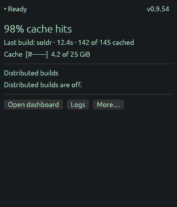 | 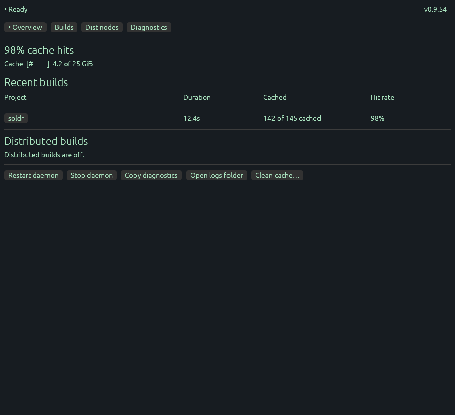 |
| Helpers active | 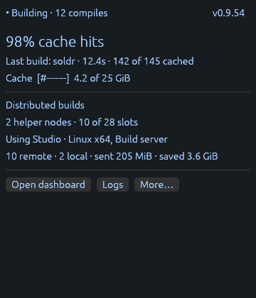 | 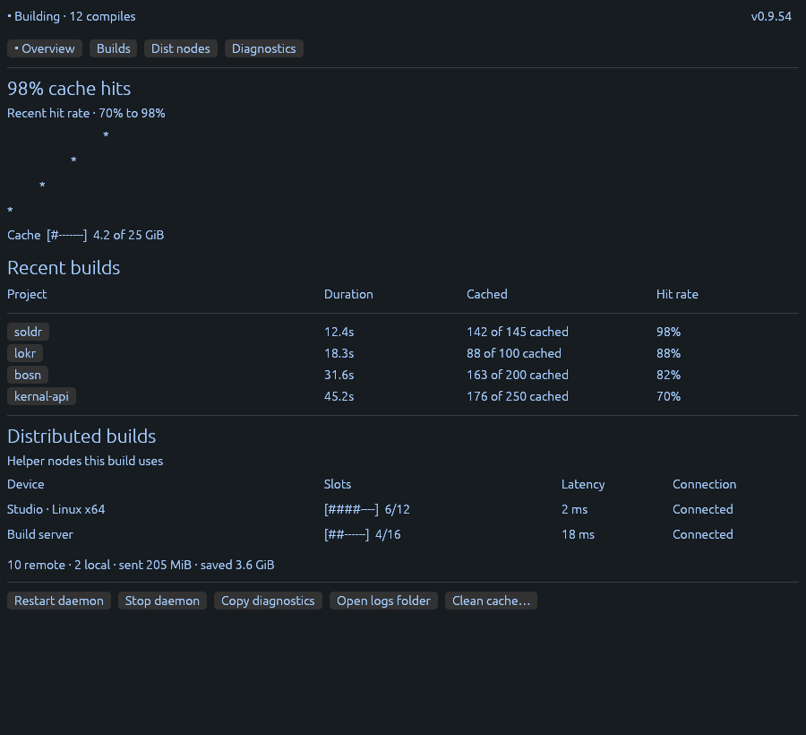 |
| Stopped | 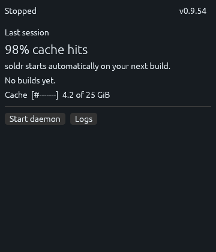 | 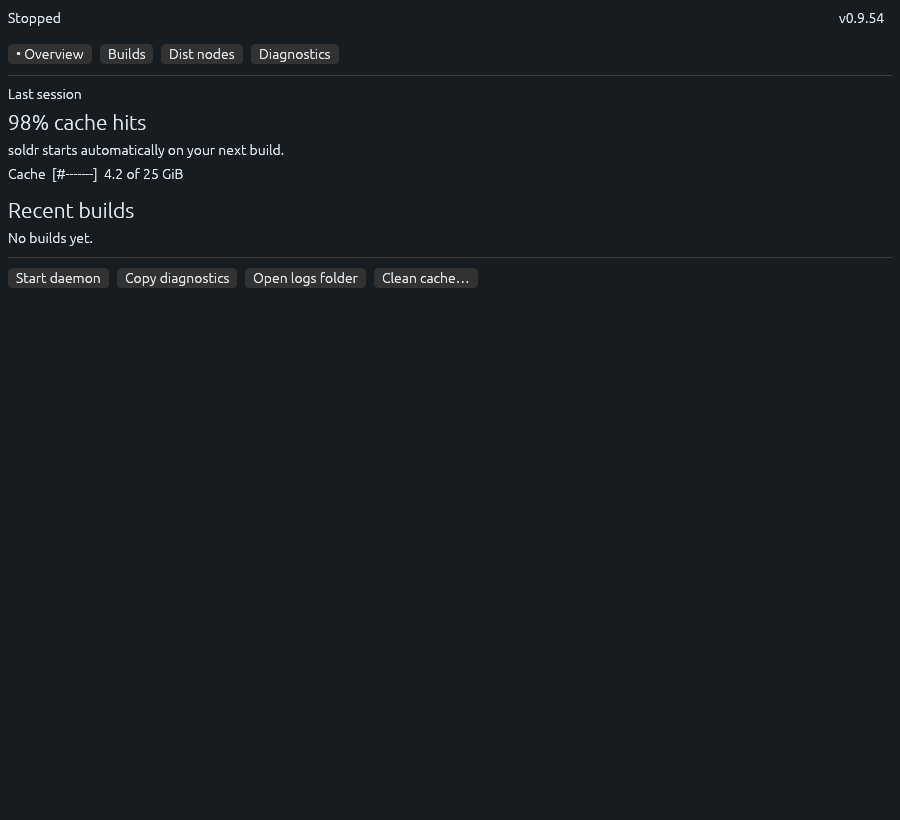 |
| No Dist capability | 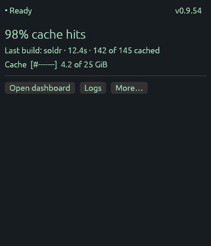 | 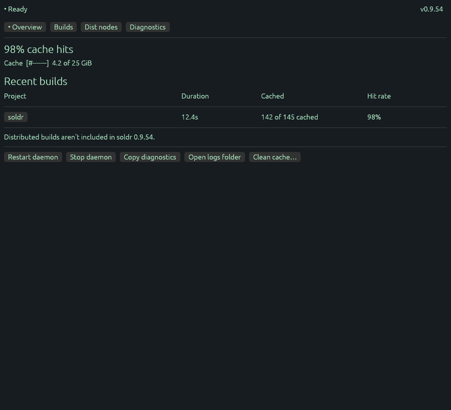 |
| Local/node build | 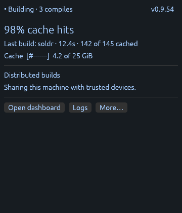 | 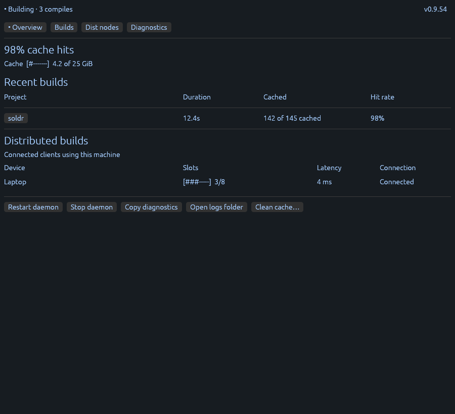 |
| Stopping | 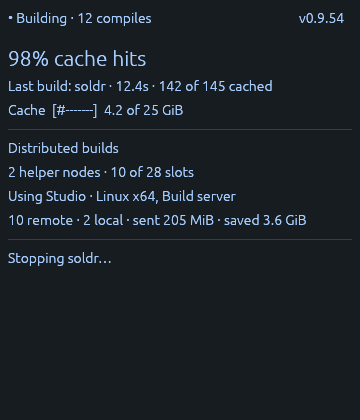 | 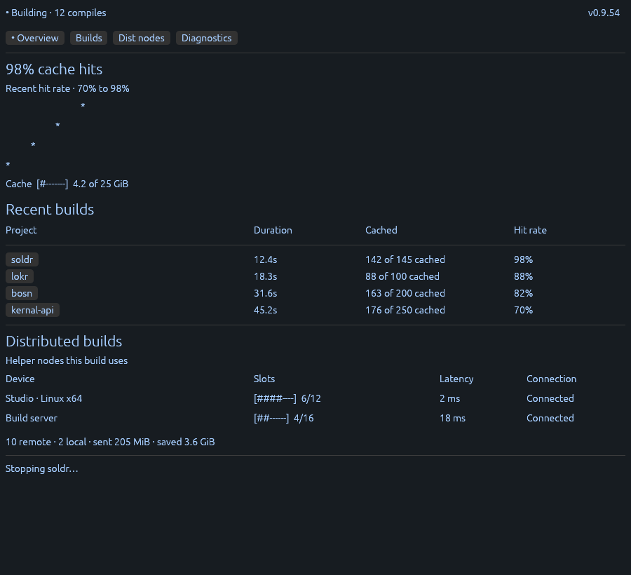 |
| Start failed | 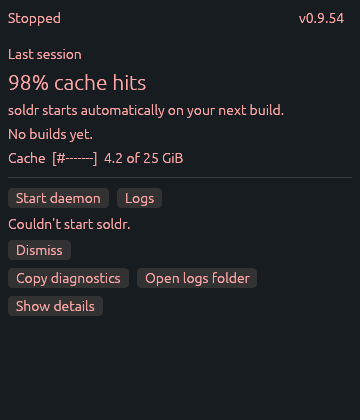 | 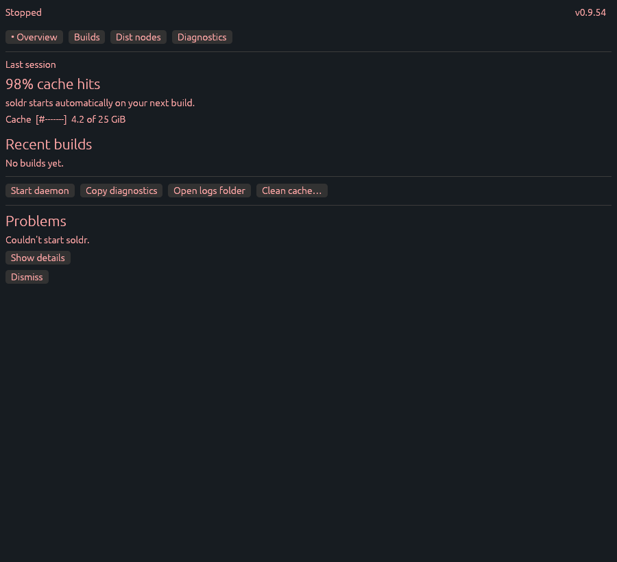 |
| 300 pixels | 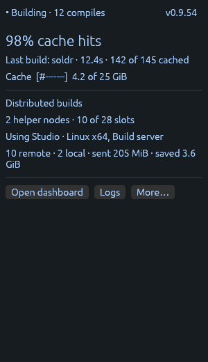 | 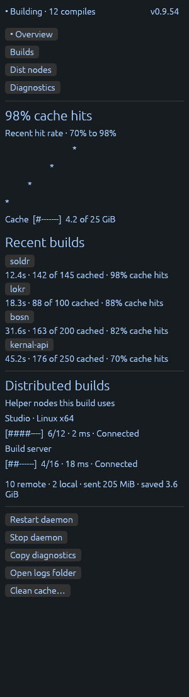 |
| 1.5× text | 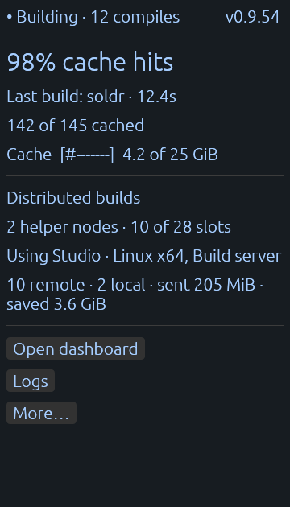 | 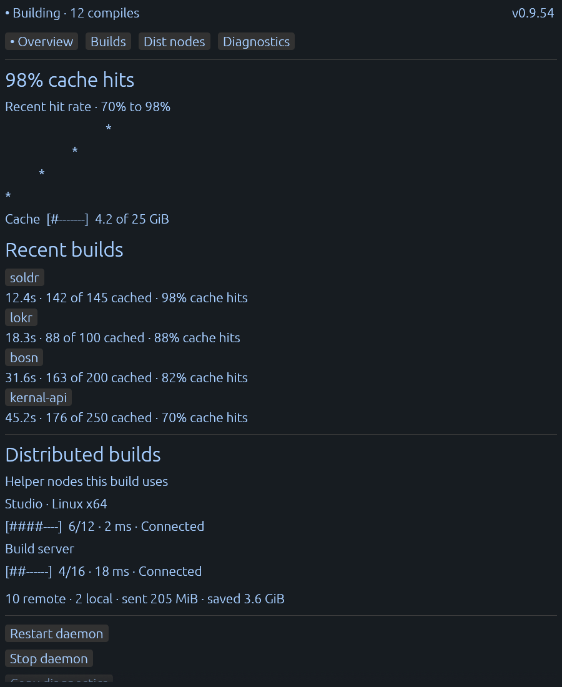 |
| Stale cache data | 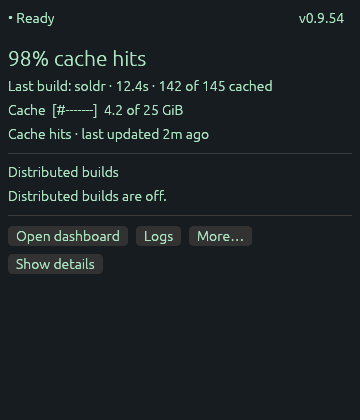 | 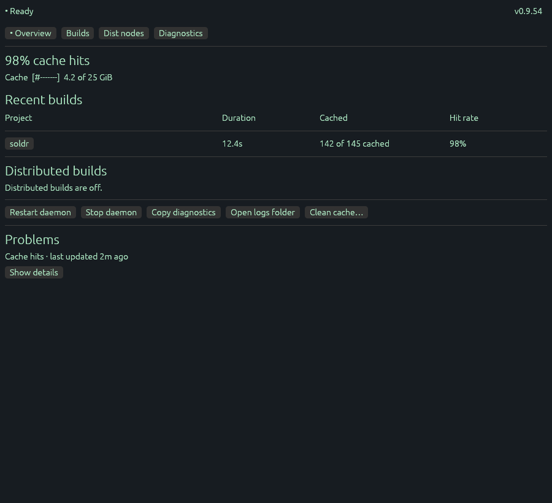 |
